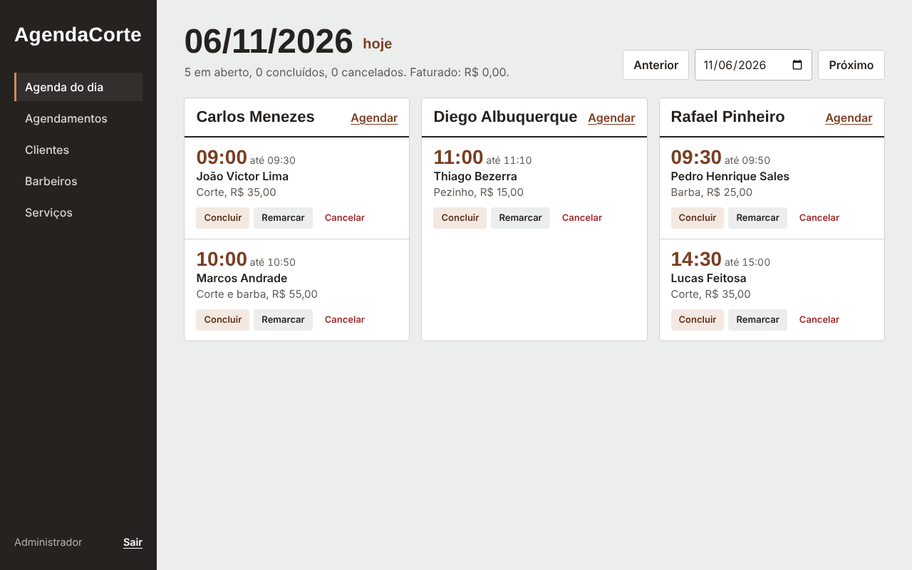

# AgendaCorte

Sistema web de agendamento para barbearias. Projeto Integrador Transdisciplinar em Engenharia de Software II.



## Funcionalidades

- Agenda do dia com uma coluna por barbeiro e resumo de atendimentos e faturamento.
- Agendamento com término calculado pela duração do serviço.
- Bloqueio de conflito de horário para barbeiro e cliente, de horários passados e fora do expediente.
- Conclusão, cancelamento e remarcação de atendimentos.
- Cadastro de clientes, barbeiros e serviços.
- Login com senha cifrada.

## Tecnologias

Python 3, Flask, SQLite, HTML, CSS, JavaScript, pytest e node:test. Arquitetura MVC.

## Como executar

```bash
python -m venv .venv
source .venv/bin/activate
pip install -r requirements.txt
flask --app app run
```

No Windows, ative o ambiente com `.venv\Scripts\activate`.

Abra `http://127.0.0.1:5000` e entre com `admin@agendacorte.local` e senha `admin123`.

## Testes

```bash
python -m pytest -v
npm test
```

## Documentação

| Etapa | Documento |
|---|---|
| Situação 1 | [Escopo](docs/situacao-1/01-escopo.md) |
| | [Requisitos e regras de negócio](docs/situacao-1/02-requisitos.md) |
| | [Modelagem UML](docs/situacao-1/03-modelagem-uml.md) |
| | [Interface (IHC)](docs/situacao-1/04-ihc.md) |
| | [Banco de dados e dicionário de dados](docs/situacao-1/05-banco-de-dados.md) |
| Situação 2 | [Arquitetura](docs/situacao-2/arquitetura.md) |
| | [Manual de uso](docs/situacao-2/manual-de-uso.md) |
| | [Telas](docs/situacao-2/telas/) |
| Situação 3 | [Plano e registro de testes](docs/situacao-3/plano-de-testes.md) |
| | [Formulário de teste para usuários](docs/situacao-3/formulario-teste-usuario.md) |
| | [Consolidação do feedback](docs/situacao-3/consolidacao-feedback.md) |
