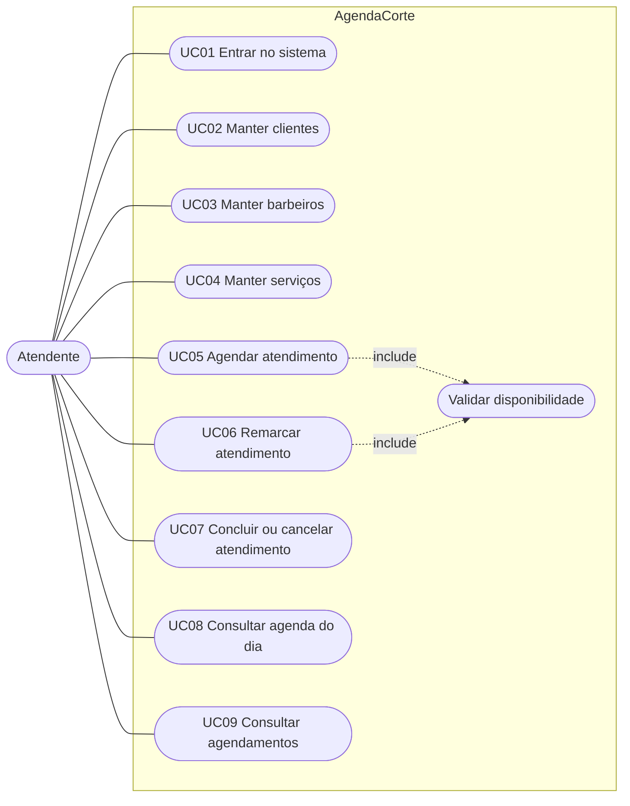
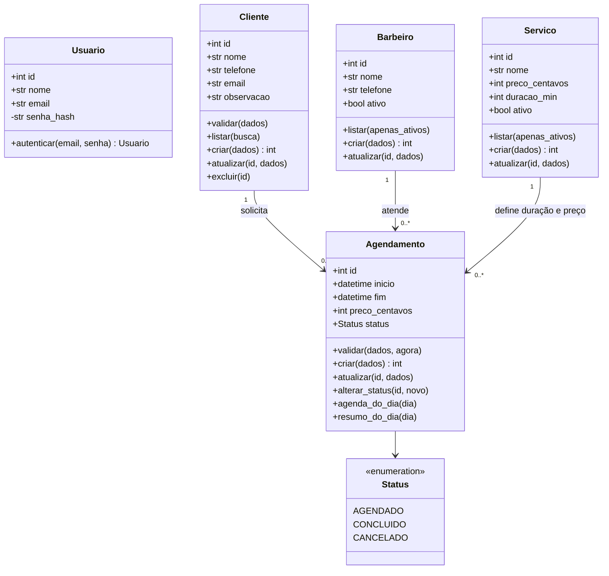
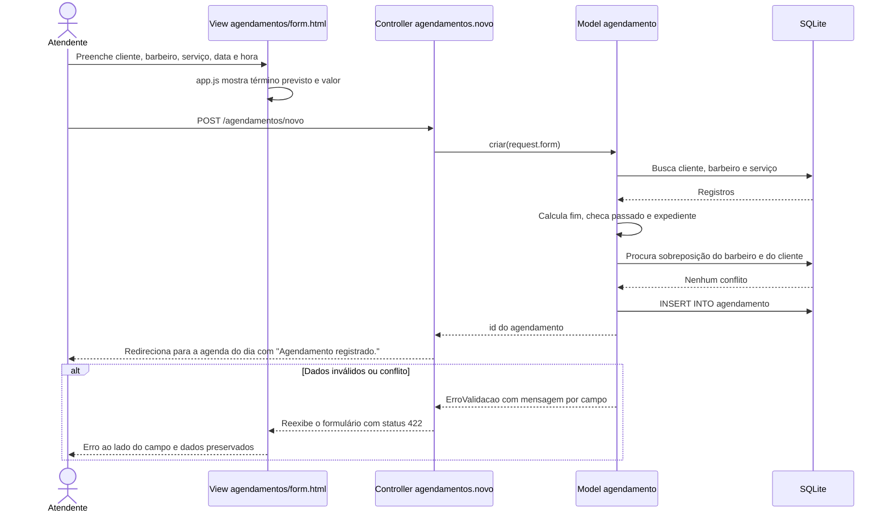
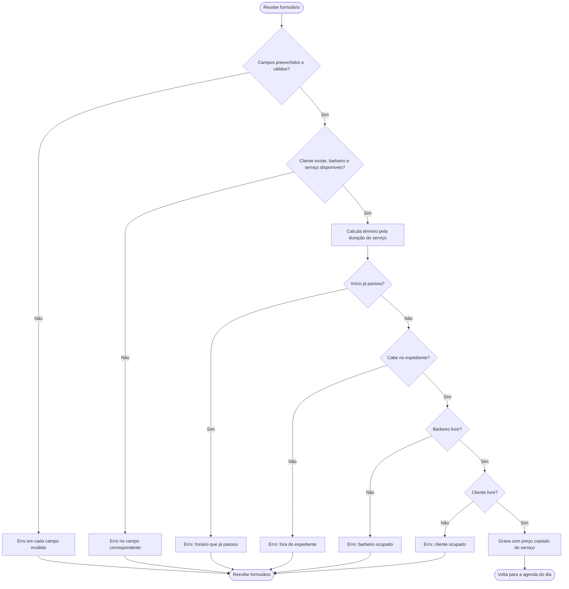
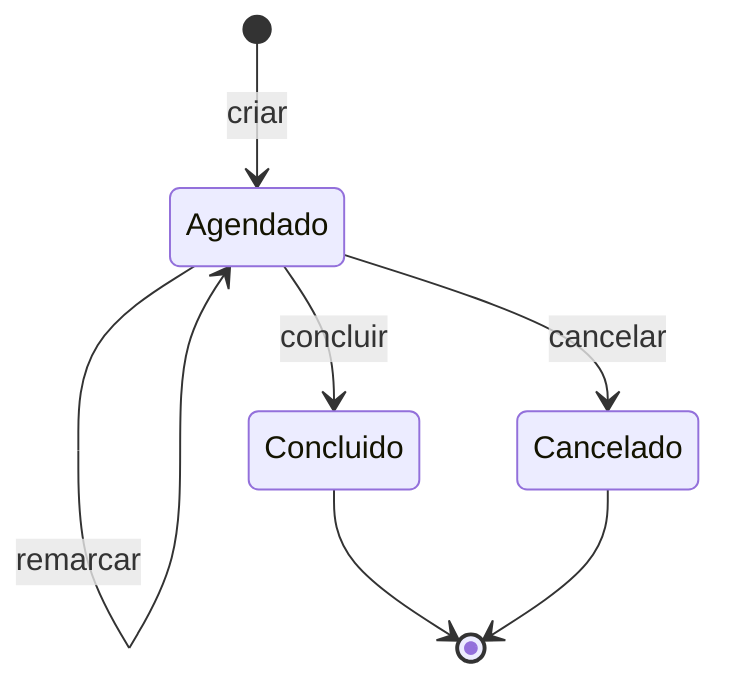

# Modelagem UML

Os diagramas estão em Mermaid, formato que o GitHub desenha direto na página do repositório.

## Diagrama de casos de uso

### Especificação: UC05 Agendar atendimento

| Item | Descrição |
|---|---|
| Ator | Atendente |
| Pré-condição | Usuário autenticado; ao menos um cliente, um barbeiro disponível e um serviço disponível cadastrados. |
| Fluxo principal | 1. Atendente abre "Novo agendamento" pelo menu, pela coluna de um barbeiro ou pela lista de clientes. 2. Sistema mostra o formulário já preenchido com o que veio da origem (dia, barbeiro ou cliente). 3. Atendente escolhe cliente, barbeiro, serviço, data e hora. 4. Sistema mostra o término previsto e o valor. 5. Atendente confirma. 6. Sistema valida (RN01 a RN05), grava e volta para a agenda do dia escolhido. |
| Fluxo alternativo A1 | Faltam cadastros: sistema mostra o que falta e oferece links para cadastrar. |
| Exceção E1 | Campo obrigatório vazio ou inválido: sistema marca o campo e explica o erro. |
| Exceção E2 | Horário no passado, fora do expediente ou em conflito: sistema mantém os dados e explica o motivo. |
| Pós-condição | Agendamento gravado com situação "Agendado", término calculado e preço copiado do serviço. |

### Especificação: UC07 Concluir ou cancelar atendimento

| Item | Descrição |
|---|---|
| Ator | Atendente |
| Pré-condição | Agendamento com situação "Agendado". |
| Fluxo principal | 1. Na agenda do dia, atendente clica em "Concluir" ou "Cancelar". 2. Para cancelar, sistema pede confirmação. 3. Sistema muda a situação e atualiza o resumo do dia. |
| Exceção E1 | Agendamento já concluído ou cancelado: sistema recusa e informa a situação atual. |

## Diagrama de classes

## Diagrama de sequência: agendar atendimento

## Diagrama de atividades: validação do agendamento

## Diagrama de estados do agendamento

