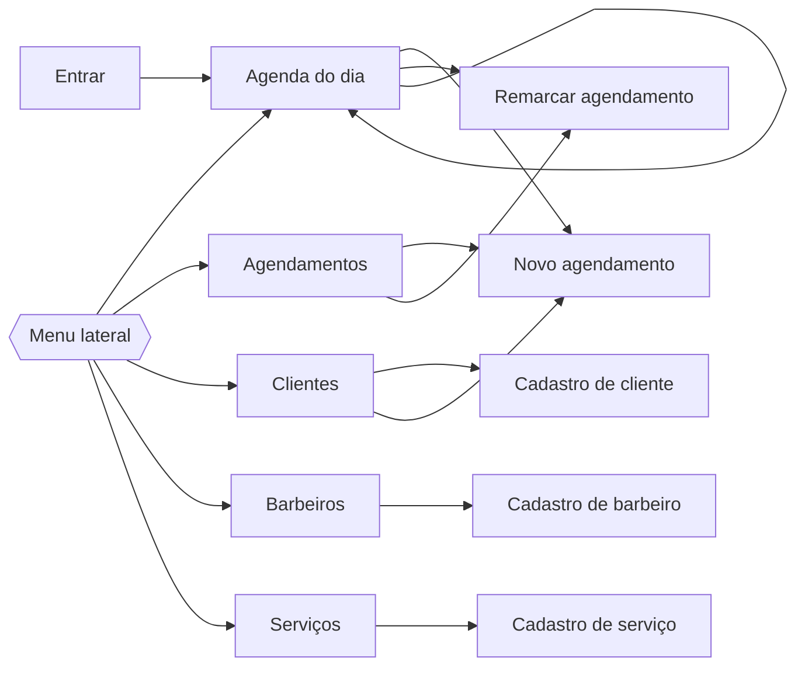

# Interface (IHC)

## Mapa de navegação

## Telas

| Tela | Conteúdo | Decisões de interface |
|---|---|---|
| Entrar | E-mail, senha e botão "Entrar". | Foco automático no e-mail; mensagem única para e-mail ou senha errados, sem revelar qual dos dois falhou. |
| Agenda do dia | Data em destaque, resumo do dia, navegação entre dias e uma coluna por barbeiro com os horários em ordem. | O horário é o elemento mais visível de cada atendimento, porque é o que a recepção procura primeiro. Cancelados aparecem riscados e concluídos em verde para leitura rápida. |
| Novo agendamento / Remarcar | Cliente, barbeiro, serviço, data e hora. | Término e valor calculados na hora da escolha; campos chegam preenchidos quando a tela é aberta a partir de um barbeiro, dia ou cliente. |
| Agendamentos | Tabela com filtros por dia, barbeiro e situação. | Sem dia escolhido, mostra de hoje em diante para não misturar histórico antigo. |
| Clientes | Busca por nome ou telefone e tabela. | Atalho "Agendar" em cada linha. |
| Cadastro de cliente | Nome, telefone, e-mail e observações. | Máscara de telefone durante a digitação; exclusão separada do formulário e com confirmação. |
| Barbeiros e Serviços | Tabela e formulário com caixa "Disponível para agendamentos". | Desativar em vez de excluir preserva o histórico (RN09). |

## Identidade visual

| Elemento | Escolha |
|---|---|
| Cor de destaque | Marrom couro `#7a3e22`, das cadeiras e estojos de barbearia. Usado em botões principais, horários e item ativo do menu. |
| Base | Fundo cinza claro `#eceeed`, superfícies brancas, texto `#26221f`. |
| Estados | Verde `#2e6b4a` para concluído e sucesso; vermelho `#9e2a2b` para erro e ações destrutivas. |
| Tipografia | Barlow Condensed nos títulos e horários, lembrando letreiro de fachada; Barlow no texto corrido. Fontes do sistema como alternativa offline. |
| Estrutura | Menu lateral fixo no computador; no celular o menu vai para o topo e as colunas da agenda ficam empilhadas. |

## Mensagens do sistema

| Situação | Mensagem | Tipo |
|---|---|---|
| Login inválido | E-mail ou senha incorretos. | Erro |
| Formulário com erro | Corrija os campos destacados para continuar. | Erro |
| Nome curto ou longo | Informe um nome entre 2 e 80 caracteres. | Erro no campo |
| Telefone ausente | Informe o telefone com DDD. | Erro no campo |
| Telefone inválido | O telefone precisa de DDD e 8 ou 9 dígitos. | Erro no campo |
| Telefone repetido | Já existe um cliente com este telefone. | Erro no campo |
| E-mail inválido | Informe um e-mail válido, como nome@exemplo.com. | Erro no campo |
| Preço inválido | Informe um preço válido, como 35,00. | Erro no campo |
| Duração inválida | A duração precisa estar entre 5 e 240 minutos. | Erro no campo |
| Horário no passado | Escolha um horário que ainda não passou. | Erro no campo |
| Fora do expediente | O atendimento precisa caber no expediente: segunda a sábado, das 8h às 20h. | Erro no campo |
| Barbeiro ocupado | O barbeiro já tem um atendimento nesse horário. | Erro no campo |
| Cliente ocupado | O cliente já tem um atendimento nesse horário. | Erro no campo |
| Barbeiro ou serviço indisponível | Este barbeiro não está disponível. / Este serviço não está disponível. | Erro no campo |
| Exclusão bloqueada | Este cliente tem agendamentos registrados e não pode ser excluído. | Erro |
| Mudança de situação inválida | Um agendamento concluído não pode passar para cancelado. | Erro |
| Página inexistente | A página procurada não existe. | Página de erro |
| Falha inesperada | Ocorreu um erro inesperado. Tente de novo em instantes. | Página de erro |
| Confirmações | Cancelar o atendimento de (cliente) às (hora)? / Excluir este cliente? Essa ação não pode ser desfeita. | Diálogo |
| Sucesso | Cliente cadastrado. / Agendamento registrado. / Agendamento marcado como concluído. | Sucesso |

## Princípios aplicados

| Princípio | Onde aparece |
|---|---|
| Clareza | Um único botão principal por tela, com verbo que diz o que acontece ("Agendar", "Salvar cliente"). |
| Consistência | Todos os cadastros seguem lista, botão de cadastro no topo e formulário com o mesmo layout. |
| Feedback | Mensagem após cada ação; previsão de término antes de confirmar o agendamento. |
| Prevenção de erros | Máscara de telefone, campos de data e hora nativos, confirmação antes de ações sem volta. |
| Recuperação | Erros mantêm tudo o que foi digitado; remarcar desfaz uma marcação errada sem apagar o registro. |
| Controle do usuário | Navegação livre entre dias e filtros que podem ser limpos com um clique. |

As telas finais estão em `docs/situacao-2/telas/` (capturas feitas na execução local).
