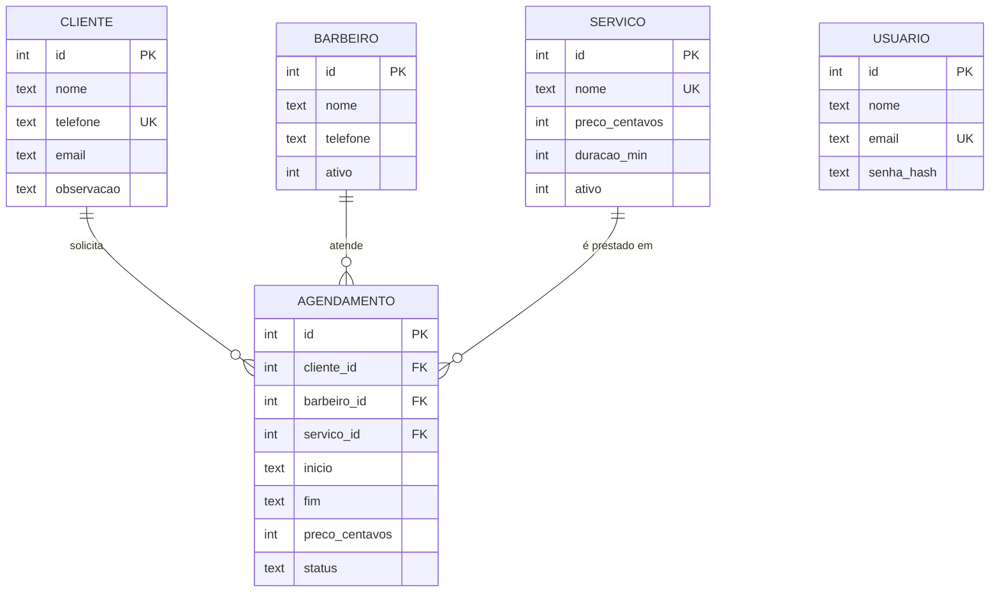

# Projeto de banco de dados

## Projeto conceitual



Cardinalidades: um cliente tem zero ou muitos agendamentos e cada agendamento pertence a exatamente um cliente. O mesmo vale para barbeiro e serviço. Cada agendamento tem um único serviço; um atendimento com corte e barba usa o serviço combinado "Corte e barba", o que mantém o modelo simples e o preço do combo controlado pela barbearia. `USUARIO` não se relaciona com as demais entidades nesta versão.

## Projeto lógico

```
USUARIO     (id, nome, email, senha_hash, criado_em)
CLIENTE     (id, nome, telefone, email, observacao, criado_em)
BARBEIRO    (id, nome, telefone, ativo)
SERVICO     (id, nome, preco_centavos, duracao_min, ativo)
AGENDAMENTO (id, cliente_id, barbeiro_id, servico_id, inicio, fim, preco_centavos, status, criado_em)
             cliente_id  referencia CLIENTE(id)
             barbeiro_id referencia BARBEIRO(id)
             servico_id  referencia SERVICO(id)
```

### Normalização

| Forma normal | Verificação |
|---|---|
| 1FN | Todos os atributos são atômicos. Cliente tem um único telefone; o serviço do atendimento é uma chave, não uma lista. Não há grupos repetidos. |
| 2FN | Todas as tabelas têm chave primária simples (`id`), então não existe dependência parcial de parte da chave. |
| 3FN | Nenhum atributo não chave depende de outro atributo não chave. Nome do cliente, do barbeiro e do serviço ficam só nas tabelas de origem e são obtidos por junção. |

`agendamento.preco_centavos` não é redundância: é o preço cobrado naquele atendimento (RN06), um fato do agendamento. O preço em `servico` é o preço atual de tabela e pode mudar sem afetar o histórico.

`agendamento.fim` é derivável de `inicio` + `duracao_min` do serviço, mas a duração do serviço pode mudar depois da marcação. Gravar `fim` preserva o horário combinado e permite detectar sobreposição com uma consulta simples e indexada.

## Projeto físico

SGBD: SQLite 3. Script completo em [`app/schema.sql`](../../app/schema.sql); dados de exemplo em [`app/seed.sql`](../../app/seed.sql).

Decisões:

- Datas e horas em `TEXT` no formato `AAAA-MM-DD HH:MM`. O SQLite não tem tipo de data nativo, e esse formato ordena e compara corretamente como texto, o que permite a checagem de conflito `inicio < fim_novo AND fim > inicio_novo`.
- Valores em centavos (`INTEGER`) para evitar erro de arredondamento de ponto flutuante.
- Booleanos como `INTEGER` restrito a 0 e 1.
- `PRAGMA foreign_keys = ON` em toda conexão, porque o SQLite vem com chaves estrangeiras desligadas.
- `ON DELETE RESTRICT` nas chaves de `agendamento`: o banco recusa apagar cliente, barbeiro ou serviço com histórico, repetindo RN08 e RN09.
- Índices em `(barbeiro_id, inicio)` e `(cliente_id, inicio)` para a busca de conflitos, e em `inicio` para a agenda do dia.

Criação do banco:

```bash
flask --app app init-db --seed
```

## Dicionário de dados

### usuario

| Coluna | Tipo | Nulo | Chave | Domínio e restrições | Descrição |
|---|---|---|---|---|---|
| id | INTEGER | Não | PK | Autoincremento | Identificador do usuário. |
| nome | TEXT | Não | | 2 a 80 caracteres | Nome exibido no menu. |
| email | TEXT | Não | UK | Formato de e-mail, guardado em minúsculas | Login de acesso. |
| senha_hash | TEXT | Não | | Hash PBKDF2 | Senha cifrada; a senha em texto nunca é gravada. |
| criado_em | TEXT | Não | | Data e hora local, padrão no momento da inserção | Data de cadastro. |

### cliente

| Coluna | Tipo | Nulo | Chave | Domínio e restrições | Descrição |
|---|---|---|---|---|---|
| id | INTEGER | Não | PK | Autoincremento | Identificador do cliente. |
| nome | TEXT | Não | | 2 a 80 caracteres | Nome completo. |
| telefone | TEXT | Não | UK | Somente dígitos, 10 ou 11 (DDD + número) | Contato principal; impede cadastro em dobro. |
| email | TEXT | Sim | | Formato de e-mail, até 120 caracteres | Contato opcional. |
| observacao | TEXT | Sim | | Até 300 caracteres | Preferências do cliente, como tipo de corte. |
| criado_em | TEXT | Não | | Data e hora local | Data de cadastro. |

### barbeiro

| Coluna | Tipo | Nulo | Chave | Domínio e restrições | Descrição |
|---|---|---|---|---|---|
| id | INTEGER | Não | PK | Autoincremento | Identificador do barbeiro. |
| nome | TEXT | Não | | 2 a 80 caracteres | Nome exibido na agenda. |
| telefone | TEXT | Sim | | Somente dígitos, 10 ou 11 | Contato do profissional. |
| ativo | INTEGER | Não | | 0 ou 1, padrão 1 | 1 aparece na agenda e aceita agendamentos. |

### servico

| Coluna | Tipo | Nulo | Chave | Domínio e restrições | Descrição |
|---|---|---|---|---|---|
| id | INTEGER | Não | PK | Autoincremento | Identificador do serviço. |
| nome | TEXT | Não | UK | 2 a 60 caracteres | Nome do serviço, como "Corte". |
| preco_centavos | INTEGER | Não | | 1 a 1.000.000 (R$ 0,01 a R$ 10.000,00) | Preço atual de tabela. |
| duracao_min | INTEGER | Não | | 5 a 240 | Tempo do atendimento em minutos. |
| ativo | INTEGER | Não | | 0 ou 1, padrão 1 | 1 aparece nas opções de agendamento. |

### agendamento

| Coluna | Tipo | Nulo | Chave | Domínio e restrições | Descrição |
|---|---|---|---|---|---|
| id | INTEGER | Não | PK | Autoincremento | Identificador do agendamento. |
| cliente_id | INTEGER | Não | FK cliente(id) | RESTRICT na exclusão | Cliente atendido. |
| barbeiro_id | INTEGER | Não | FK barbeiro(id) | RESTRICT na exclusão | Barbeiro responsável. |
| servico_id | INTEGER | Não | FK servico(id) | RESTRICT na exclusão | Serviço prestado. |
| inicio | TEXT | Não | | `AAAA-MM-DD HH:MM` | Início do atendimento. |
| fim | TEXT | Não | | `AAAA-MM-DD HH:MM`, maior que `inicio` | Término calculado pela duração do serviço. |
| preco_centavos | INTEGER | Não | | Maior que 0 | Preço cobrado, copiado do serviço na marcação. |
| status | TEXT | Não | | AGENDADO, CONCLUIDO ou CANCELADO; padrão AGENDADO | Situação do atendimento. |
| criado_em | TEXT | Não | | Data e hora local | Momento da marcação. |

### Índices

| Nome | Tabela | Colunas | Uso |
|---|---|---|---|
| idx_agendamento_barbeiro_inicio | agendamento | barbeiro_id, inicio | Conflito de horário do barbeiro. |
| idx_agendamento_cliente_inicio | agendamento | cliente_id, inicio | Conflito de horário do cliente. |
| idx_agendamento_inicio | agendamento | inicio | Agenda e resumo do dia. |
