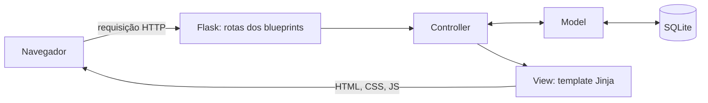

# Arquitetura

## Padrão MVC



| Camada | Pasta | Responsabilidade |
|---|---|---|
| Model | `app/models/` | Regras de negócio, validação e acesso ao banco. Não conhece HTTP nem HTML. |
| View | `app/views/` e `app/static/` | Templates Jinja, CSS e JavaScript. Só exibem dados recebidos e enviam formulários. |
| Controller | `app/controllers/` | Recebe a requisição, chama o model, escolhe a view e o código HTTP de resposta. |

Erros de regra de negócio sobem do model como `ErroValidacao`, com um dicionário `campo: mensagem`. O controller captura a exceção e devolve a mesma view com status 422, os erros e os dados digitados.

## Estrutura de pastas

```
agendacorte/
  app/
    __init__.py            fábrica da aplicação (create_app)
    db.py                  conexão, criação do banco, dados de exemplo
    schema.sql             projeto físico
    seed.sql               dados de exemplo
    models/
      validacao.py         validações e formatações reaproveitadas
      usuario.py
      cliente.py
      barbeiro.py
      servico.py
      agendamento.py       regras de horário, conflito e situação
    controllers/
      auth.py              login, logout e proteção das rotas
      painel.py            agenda do dia
      clientes.py
      barbeiros.py
      servicos.py
      agendamentos.py
    views/                 templates Jinja por módulo
    static/
      css/estilo.css
      js/app.js            máscara, previsão de término, confirmações
  tests/
    conftest.py            banco temporário e dados de teste
    test_validacao.py      unitários
    test_regras_agendamento.py  unitários
    test_modelos.py        integração model + banco
    test_rotas.py          integração controller + view
    front/app.test.js      unitários do JavaScript
  docs/
    situacao-1/  situacao-2/  situacao-3/
```

## Rotas

| Método | Caminho | Controller | Descrição |
|---|---|---|---|
| GET, POST | /login | auth.login | Formulário e autenticação. |
| POST | /logout | auth.logout | Encerra a sessão. |
| GET | / | painel.inicio | Agenda do dia (`?data=AAAA-MM-DD`). |
| GET | /clientes/ | clientes.lista | Lista e busca (`?busca=`). |
| GET, POST | /clientes/novo | clientes.novo | Cadastro. |
| GET, POST | /clientes/{id}/editar | clientes.editar | Edição. |
| POST | /clientes/{id}/excluir | clientes.excluir | Exclusão. |
| GET | /barbeiros/ | barbeiros.lista | Lista. |
| GET, POST | /barbeiros/novo | barbeiros.novo | Cadastro. |
| GET, POST | /barbeiros/{id}/editar | barbeiros.editar | Edição. |
| GET | /servicos/ | servicos.lista | Lista. |
| GET, POST | /servicos/novo | servicos.novo | Cadastro. |
| GET, POST | /servicos/{id}/editar | servicos.editar | Edição. |
| GET | /agendamentos/ | agendamentos.lista | Lista com filtros (`data`, `barbeiro_id`, `status`). |
| GET, POST | /agendamentos/novo | agendamentos.novo | Marcação (aceita `data`, `hora`, `barbeiro_id`, `cliente_id` para pré-preencher). |
| GET, POST | /agendamentos/{id}/editar | agendamentos.editar | Remarcação. |
| POST | /agendamentos/{id}/status | agendamentos.status | Concluir ou cancelar. |

## Tratamento de erros

| Situação | Resposta |
|---|---|
| Dado inválido ou regra violada | 422 com o formulário, mensagem por campo e valores preservados. |
| Usuário não autenticado | 302 para `/login`, guardando a página pedida. |
| Login errado | 401 com mensagem. |
| Registro inexistente | 404 com página de erro. |
| Exceção não prevista | 500 com página de erro sem detalhes técnicos. |
| Violação de UNIQUE no banco | Convertida em `ErroValidacao` com mensagem para o usuário. |
